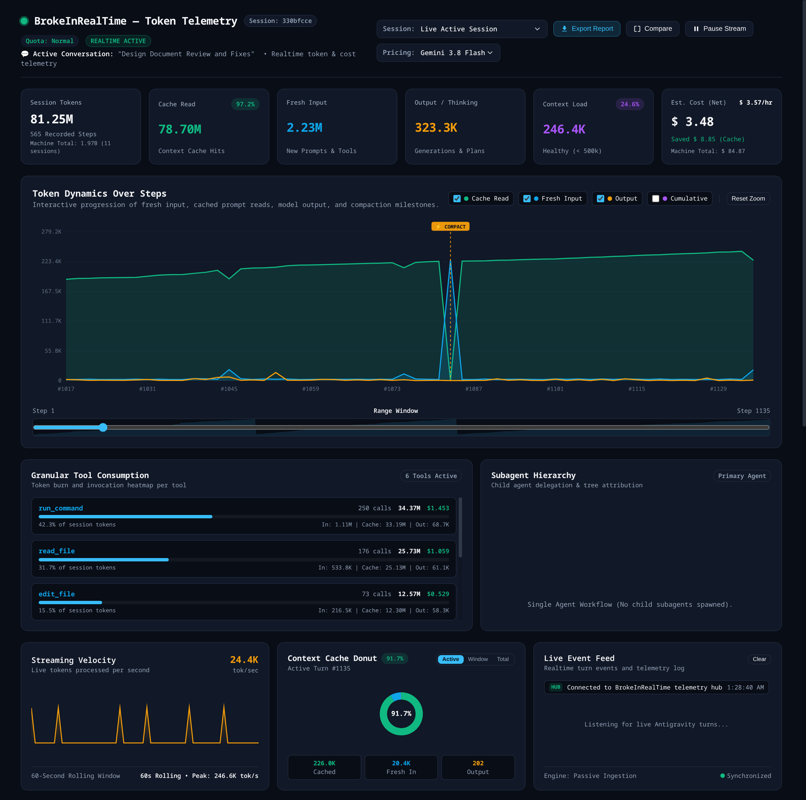

# BrokeInRealTime

**BrokeInRealTime** is an ultra-lightweight, zero-network-risk local telemetry daemon and real-time dashboard for **Google Antigravity (IDE App & `agy` CLI)**. It tracks token consumption, context caching efficiency, theoretical financial burn rate, and quota exhaustion in real time.

<p align="center">
  
</p>

---

## Key Highlights

* **100% Offline & Local (`127.0.0.1`):** No cloud servers, no remote telemetry, no external databases. All data stays strictly on your workstation.
* **Zero External Scraping:** Passively watches local Antigravity transcript logs and SQLite session tables. Never creates outbound network requests to Google or Gemini endpoints.
* **Context Cache-Aware Accounting:** Distinguishes between fresh input tokens and discounted cached read tokens (`cache_read_tokens`), displaying true theoretical cost and prompt caching dollar savings.
* **App vs. CLI Attribution:** Automatically identifies whether tokens originated in the Desktop IDE or the terminal CLI (`agy`) via native session metadata.
* **Server Quota & Cooldown Tracker:** Intercepts HTTP 429 `RESOURCE_EXHAUSTED` events to display live cooldown countdown timers.
* **Single Binary Footprint:** Compiled in Go to a self-contained executable ($< 9\text{ MB}$, $\approx 12\text{ MB}$ RSS memory, $\le 0.2\%$ idle CPU) embedding an offline, dependency-free HTML5 Canvas dashboard.

---

## One-Command Install (Recommended)

Run this single command in your terminal to install and start BrokeInRealTime automatically:

```bash
curl -fsSL https://raw.githubusercontent.com/mahin273/BrokeInRealTime/main/install.sh | bash
```

Or using `wget`:
```bash
wget -qO- https://raw.githubusercontent.com/mahin273/BrokeInRealTime/main/install.sh | bash
```

The installer will:
1. Detect your platform (Linux or macOS, amd64 or arm64).
2. Install the lightweight binary to `~/.local/bin/broke-daemon`.
3. Configure and start the user background service (`systemd --user` on Linux, `launchd` on macOS).
4. Launch the real-time telemetry dashboard immediately at:
   **`http://127.0.0.1:8088`**

### Updating BrokeInRealTime

You can update BrokeInRealTime to the latest version at any time using either method:

**Method 1: Built-in CLI command**
```bash
broke-daemon --update
# or
broke-daemon update
```

**Method 2: One-line terminal updater**
```bash
curl -fsSL https://raw.githubusercontent.com/mahin273/BrokeInRealTime/main/install.sh | bash
```

Both methods automatically verify the latest GitHub release, download the precompiled binary, update `~/.local/bin/broke-daemon`, and restart the background daemon service seamlessly.

#### Uninstall Anytime

**Option 1: Built-in CLI command**
```bash
broke-daemon uninstall
```

**Option 2: One-line uninstaller**
```bash
curl -fsSL https://raw.githubusercontent.com/mahin273/BrokeInRealTime/main/uninstall.sh | bash
```

Both methods cleanly terminate and disable background services (`systemd --user` or `launchd`), remove service definition files, and delete the executable.

---

## Manual Build & Quickstart

### Prerequisites
* [Go 1.22+](https://golang.org) (Pure Go, 100% CGO-free, zero C compiler required).

### Build from Source
```bash
git clone git@github.com:mahin273/BrokeInRealTime.git
cd BrokeInRealTime

# Build stripped binary
go build -ldflags="-s -w" -o broke-daemon ./cmd/broke-daemon
```

### Run
```bash
./broke-daemon
```

Open your browser to:
 **`http://127.0.0.1:8088`**

### Command-Line Options
```text
Usage of ./broke-daemon:
  --port int
        Port to listen on (strictly bound to 127.0.0.1) (default 8088)
  --antigravity-dir string
        Path to Antigravity data dir (defaults to ~/.gemini/antigravity)
  --config string
        Path to custom pricing.json
  --no-backfill
        Do not backfill existing conversation history on launch
  --update
        Check GitHub for updates and self-update daemon to latest release
  --force
        Force reinstall of latest release even if version matches
  --uninstall
        Cleanly uninstall daemon, stop and remove background service
  --version
        Print version and exit
```

---

## Background Service Setup

### Linux (`systemd --user`)
1. Copy the compiled binary to your local bin:
   ```bash
   install -m 755 broke-daemon ~/.local/bin/
   ```
2. Install and enable the systemd user service:
   ```bash
   mkdir -p ~/.config/systemd/user/
   cp service/brokeinrealtime.service ~/.config/systemd/user/
   systemctl --user daemon-reload
   systemctl --user enable --now brokeinrealtime
   ```
3. Check status:
   ```bash
   systemctl --user status brokeinrealtime
   ```

### macOS (`launchd`)
1. Copy the binary:
   ```bash
   sudo cp broke-daemon /usr/local/bin/
   ```
2. Copy the plist and start the agent:
   ```bash
   mkdir -p ~/Library/LaunchAgents/
   cp service/com.user.brokeinrealtime.plist ~/Library/LaunchAgents/
   launchctl load ~/Library/LaunchAgents/com.user.brokeinrealtime.plist
   ```

---

## Pricing Configuration

Model rates can be customized in `pricing.json` (or placed in `~/.config/brokeinrealtime/pricing.json`):

```json
{
  "models": {
    "gemini-3.8-flash": {
      "input_per_million": 0.15,
      "cache_per_million": 0.0375,
      "output_per_million": 0.60
    },
    "argon": {
      "input_per_million": 1.25,
      "cache_per_million": 0.3125,
      "output_per_million": 5.00
    }
  }
}
```

---

## Security

* **127.0.0.1 Binding:** Refuses external interfaces (`0.0.0.0`).
* **Cross-Site WebSocket Hijacking (CSWSH) Protection:** Verifies the `Origin` header on WebSocket handshakes to block untrusted browser origins from reading token activity.
* **Non-Blocking Read-Only Access:** All file handles are opened with `O_RDONLY` and shared locks.

---

## License
MIT License.
